<picture>
  <source media="(prefers-color-scheme: dark)" srcset="./assets/banner-dark.svg">
  <source media="(prefers-color-scheme: light)" srcset="./assets/banner-light.svg">
  
</picture>

  <samp>
    <a href="https://github.com/shorrysorry/skills">agent skills</a> ·
    <a href="https://github.com/shorrysorry?tab=repositories">repos</a>
  </samp>

## 👋 About

**4년 차를 넘긴 프론트엔드 개발자**입니다. React · Next.js · TypeScript로 B2B SaaS 제품을 만들고,
요즘은 **AI 에이전트를 실제 개발 프로세스 안에 녹이는 일**에 가장 많은 시간을 씁니다.

> AI가 코드를 쓰는 시대에도, *무엇을 만들지*와 *그 결과의 품질*은 사람이 책임진다고 믿습니다.
> 그래서 에이전트에게 일을 맡기는 만큼, 검증하는 구조를 함께 만듭니다.

## 🧭 Now

- 🏢 채용 SaaS의 프론트엔드 모노레포 개발 — 백오피스 · 채용 사이트 · Chrome 확장 · Electron 데스크톱 앱
- 🤖 Claude Code · Codex 기반 **팀 AI 개발 워크플로** 개선에 기여 — 멀티 에이전트, hooks, skills, MCP
- 📚 쓸 만한 오픈소스 agent skills를 모아 분류하는 중 → [**shorrysorry/skills**](https://github.com/shorrysorry/skills)

## 🤖 How I work with AI

| 단계 | 사람(나)이 하는 일 | 에이전트에게 맡기는 일 |
|---|---|---|
| **Plan** | 문제 정의, 범위·우선순위 결정 | 요구사항 인터뷰, 스펙 · 구현 계획 초안 |
| **Build** | 설계 판단, 경계 조건 결정 | 태스크 분해, 서브에이전트 병렬 구현, TDD Red → Green |
| **Verify** | 결과 승인, 트레이드오프 판단 | 타입체크 · 테스트 · 코드 리뷰, 증거 수집 |
| **QA** | 사용자 관점 최종 확인 | 브라우저 자동화로 실제 화면 검증 (Playwright) |

원칙 — 추측보다 근거 · 증거 없는 "완료" 금지 · 요청한 것만 변경

## 🛠 Stack

  

  

- **AI** —    
- **State & Data** — SWR · Recoil · Zustand
- **UI** — Ant Design · styled-components
- **Test** — Vitest · Testing Library · Playwright
- **Monorepo** — Turborepo · Yarn Workspaces

---

코드 한 줄에도 사람의 판단이 묻어나는 개발자를 지향합니다.

